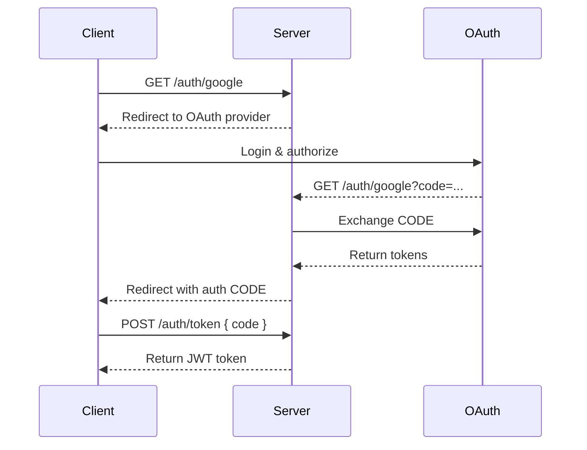

# API Reference

Complete API reference for Nuxt Aegis.

## Public Imports

| Import Path | Contents | Context |
|-------------|----------|---------|
| `#nuxt-aegis/types` | Shared types, including token claims and provider configuration | App, server, shared code, and configuration |
| `#nuxt-aegis/app` | `useAuth`, `useAegisFetch` | App code, including SSR |
| `#nuxt-aegis/server` | Server operations, provider factories, and server-only types | Server code |

```typescript
import type { BaseTokenClaims, PasswordProviderConfig, OAuthTransactionConfig } from '#nuxt-aegis/types'
import { useAuth, useAegisFetch } from '#nuxt-aegis/app'
```

In server code:

```typescript
import { requireAuth, defineOAuthGoogleEventHandler } from '#nuxt-aegis/server'
import type { AegisHandler, UserPersistContext } from '#nuxt-aegis/server'
```

App composables and server operations remain auto-imported in their respective contexts. The built-in OAuth factories (`defineOAuthGoogleEventHandler`, `defineOAuthGithubEventHandler`, `defineOAuthAuth0EventHandler`, and `defineOAuthMockEventHandler`) are also server auto-imports; server-only types are never globals.

Documented server operations include `requireAuth`, `getAuthUser`, `generateAuthTokens`, `revokeRefreshToken`, `deleteUserRefreshTokens`, `recomputeCustomClaims`, `defineAegisHandler`, `useAegisHandler`, and the four built-in OAuth factories.

## Client-Side API

### Composables

- [`useAuth()`](/api/composables) - Authentication state and methods
- [`useAegisFetch()`](/api/fetch-plugin#useaegisfetch) - Reactive authenticated fetching with SSR/hydration reuse

## Server-Side API

### HTTP Endpoints

- [Authentication Endpoints](/api/endpoints) - REST API for authentication flows

### Server Utilities

- [Authentication Utils](/api/server-utils) - Server-side helper functions

### Event Handlers

- [OAuth Handlers](/api/event-handlers) - Define OAuth provider endpoints

## Type Definitions

- [TypeScript Types](/api/types) - Type definitions and interfaces

## Quick Reference

### Authentication Flow



### Common Operations

| Operation | Client API | Server API |
|-----------|------------|------------|
| Check auth | `const { authStatus, isLoggedIn } = useAuth()` | `await getAuthUser(event)` |
| Get user | `const { user } = useAuth()` | `await requireAuth(event)` |
| Login | `await login('google')` | N/A |
| Logout | `await logout()` | N/A |
| Refresh | `await refresh()` | N/A |
| Resolve startup auth | `await ensureResolved()` | N/A |
