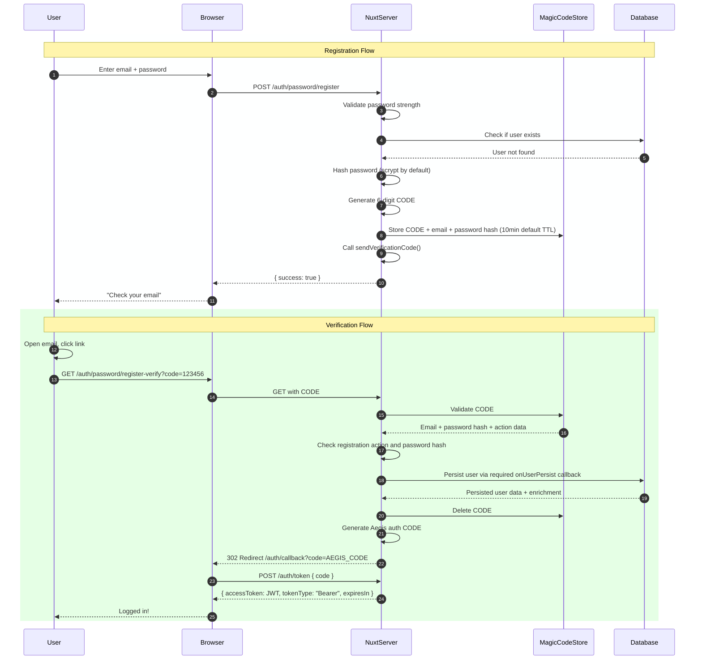

# Authentication Flow

Complete step-by-step authentication flow from login to token exchange.

## Overview

Nuxt Aegis implements a secure multi-stage authentication flow that combines OAuth 2.0, authorization CODEs, and JWT tokens. This page details the complete authentication process from initial login through token refresh.

The stages below describe work performed by the module and the OAuth provider, not implementation steps for your application. Code blocks labeled **Application Usage** are application-facing examples; request/response contracts describe the module's transport without requiring you to recreate its handlers. Paths shown use the default Aegis endpoints and an application-defined `/auth/google` provider route.

## Complete Authentication Flow

```mermaid
sequenceDiagram
    autonumber
    participant User
    participant Browser
    participant NuxtServer
    participant AuthCodeStore
    participant RefreshStorage
    participant OAuth

    rect rgba(255, 0, 0, 0.1)
        Note over User,OAuth: Stage 1: OAuth Initiation
        User->>Browser: Click "Login with Google"
        Browser->>NuxtServer: GET /auth/google
        NuxtServer->>NuxtServer: Build authorization URL with supplied state/redirectTo
        NuxtServer-->>User: 302 Redirect to OAuth provider
    end

    rect rgba(0, 255, 0, 0.1)
        Note over User,OAuth: Stage 2: OAuth Authorization
        User->>OAuth: Authorize application
        OAuth->>OAuth: User authenticates
        OAuth->>OAuth: User grants permissions
        OAuth-->>NuxtServer: 302 Redirect with auth CODE
    end

    rect rgba(0, 0, 255, 0.1)
        Note over User,OAuth: Stage 3: Token Exchange with Provider
        NuxtServer->>OAuth: POST /token (exchange auth CODE)
        OAuth-->>NuxtServer: Access token; refresh token and ID token if issued
        NuxtServer->>OAuth: GET /userinfo (with access token)
        OAuth-->>NuxtServer: User profile data
    end

    rect rgba(255, 245, 255, 0.1)
        Note over User,OAuth: Stage 4: Aegis Authorization CODE
        NuxtServer->>NuxtServer: Transform and enrich user info via configured callbacks
        NuxtServer->>NuxtServer: Resolve custom claims
        NuxtServer->>NuxtServer: Generate Aegis auth CODE (60s TTL)
        NuxtServer->>AuthCodeStore: Store CODE → user data
        NuxtServer-->>Browser: 302 Redirect /auth/callback?code=AEGIS_CODE
    end

    rect rgba(255, 255, 0, 0.1)
        Note over User,OAuth: Stage 5: JWT Token Exchange
        Browser->>NuxtServer: POST /auth/token { code: AEGIS_CODE }
        NuxtServer->>AuthCodeStore: Validate & retrieve user data
        AuthCodeStore-->>NuxtServer: User data
        NuxtServer->>AuthCodeStore: Delete CODE (single-use)
        opt Application refresh tokens enabled
          NuxtServer->>NuxtServer: Generate Aegis refresh token
          NuxtServer->>RefreshStorage: Store refresh token record + user data + custom claims
        end
        NuxtServer->>NuxtServer: Generate JWT access token
        opt Application refresh tokens enabled
          NuxtServer-->>Browser: Set Aegis refresh token cookie (HttpOnly)
        end
        NuxtServer-->>Browser: { accessToken: JWT, tokenType: "Bearer", expiresIn }
        Browser->>Browser: Store JWT in memory only
        Browser-->>User: Redirect to app (logged in!)
    end

    rect rgba(200, 200, 200, 0.1)
        Note over User,Browser: Stage 6: Using $api for Authenticated Requests
        User->>Browser: Navigate to protected page
        Browser->>Browser: $api intercepts request
        Browser->>Browser: Attach bearer token automatically
        Browser->>NuxtServer: GET /api/user/profile (Authorization: Bearer JWT)
        NuxtServer->>NuxtServer: Validate JWT token
        NuxtServer-->>Browser: User profile data
        
        alt 401 response with automatic refresh enabled
            Browser->>Browser: $api detects 401
            Browser->>NuxtServer: POST /auth/refresh (automatic)
            NuxtServer-->>Browser: { success: true, message, accessToken: JWT }
            Browser->>Browser: Update token in memory
            Browser->>NuxtServer: Retry GET /api/user/profile (new token)
            NuxtServer-->>Browser: User profile data
        end
    end
```

Stage 4 creates the short-lived Aegis authorization CODE only. The application's refresh token is generated and stored during Stage 5, after `POST /auth/token` consumes that CODE, and its HttpOnly cookie is set on the token-exchange response. These steps run only when application refresh tokens are enabled; the Aegis refresh token is separate from any refresh token returned by the OAuth provider in Stage 3.

## Authentication Stages

### Stage 1: OAuth Initiation

The browser visits an application-defined provider route. The module's provider handler builds an authorization URL from the provider configuration and redirects the browser to the OAuth provider.

**Application Usage: Login Link**

For an application that has configured `/auth/google`:

```vue
<template>
  <a href="/auth/google">Login with Google</a>
</template>
```

The provider handler generates an opaque random state and an independent initiator
proof. It stores a ten-minute transaction in module-owned memory and sets a
per-transaction HttpOnly proof cookie before redirecting. Optional application
`state` and validated local `redirectTo` are stored as metadata, not encoded in the
security state. PKCE is not yet implemented.

### Stage 2: OAuth Authorization

The provider authenticates the user and obtains consent. It then redirects the browser to the application's provider route with an OAuth authorization code. This provider-issued code is distinct from the Aegis authorization code created in Stage 4.

**Provider Callback Contract**

```http
GET /auth/google?code=OAUTH_CODE&state=STATE_VALUE
```

The exact callback parameters, including whether `state` is returned, depend on the authorization request and provider.

### Stage 3: Token Exchange with Provider

The server exchanges the provider-issued authorization code at the provider's token endpoint, then uses the returned access token to fetch user information. Provider-specific implementations supply the request parameters and extract the user profile.

A provider refresh token, ID token, and expiry metadata may also be returned, depending on the provider and configuration. These are provider tokens, not the application's Aegis tokens. No application-side token exchange implementation is required.

See the [OAuth handler implementation](https://github.com/peterbud/nuxt-aegis/blob/main/src/runtime/server/providers/oauthBase.ts) for the provider exchange and profile retrieval.

### Stage 4: Aegis Authorization CODE

The module invokes configured `onUserInfo` callbacks to transform the profile, merges any enrichment returned by `onUserPersist`, and resolves custom claims. Provider-level `onUserInfo` and `customClaims` take precedence over their global handler fallbacks. Persistence enrichment does not automatically become custom JWT claims.

The module generates a random Aegis authorization code and stores the profile, provider name, resolved custom claims, and creation and expiration timestamps with it. Provider tokens remain available to configured OAuth callbacks and success hooks during authentication but are not stored in the authorization-code record. The code expires after 60 seconds by default. The server then redirects the browser to the Aegis callback page; it does not create the application's refresh token at this stage.

**Browser Redirect Contract**

```http
HTTP/1.1 302 Found
Location: /auth/callback?code=AEGIS_CODE
```

See the [OAuth handler](https://github.com/peterbud/nuxt-aegis/blob/main/src/runtime/server/providers/oauthBase.ts) and [authorization code store](https://github.com/peterbud/nuxt-aegis/blob/main/src/runtime/server/utils/authCodeStore.ts) for implementation details. For application extension points, see the [Handlers Guide](/guides/handlers) and [Custom Claims Guide](/guides/custom-claims).

### Stage 5: JWT Token Exchange

The module's `AuthCallback.vue` page handles `/auth/callback`. Its `onMounted` handler reads the Aegis code from the URL and exchanges it via `POST /auth/token`. You do not need to implement a callback plugin, sign a JWT, or manage the refresh cookie in application code.

**Code-Exchange Request Contract**

```http
POST /auth/token
Content-Type: application/json

{ "code": "AEGIS_CODE" }
```

The server retrieves and deletes a valid code before generating application tokens. A missing code produces a 400 response; an invalid, expired, or already-consumed code produces a 401 response. When refresh is enabled, the module creates and stores an Aegis refresh token and sets its HttpOnly cookie on the exchange response.

**Successful Response Contract**

```json
{
  "accessToken": "<JWT>",
  "tokenType": "Bearer",
  "expiresIn": 3600
}
```

`expiresIn` is an optional lifetime in seconds; `3600` illustrates a one-hour configuration. The endpoint omits it from JSON when the configured value cannot be converted to seconds. The response has no `token`, `expiresAt`, or `user` field. Refresh tokens are sent in an HttpOnly cookie, not in the JSON body.

The callback page stores `accessToken` in memory, derives user state from its decoded JWT claims, and redirects to the configured success destination. Application code reads that state through `useAuth().user`; decoding on the client is not server-side token verification.

See the [callback page](https://github.com/peterbud/nuxt-aegis/blob/main/src/runtime/app/pages/AuthCallback.vue), [token endpoint](https://github.com/peterbud/nuxt-aegis/blob/main/src/runtime/server/routes/token.post.ts), and [token generation utility](https://github.com/peterbud/nuxt-aegis/blob/main/src/runtime/server/utils/auth.ts) for implementation details.

### Stage 6: Using $api for Authenticated Requests

After authentication, use the `$api` plugin to make authenticated API calls:

**Application Usage: Authenticated Request**

```typescript
const { $api } = useNuxtApp()
const data = await $api('/api/user/profile')
```

On the client, `$api` attaches the in-memory token as an `Authorization: Bearer <token>` header.

**Client Refresh Behavior**

When automatic refresh is enabled, a 401 response triggers a refresh attempt and, if successful, a retry with the new access token. A 401 does not necessarily mean that the token expired. If refresh fails, the client clears its token and redirects to the configured error destination.

**Refresh Request Contract**

```http
POST /auth/refresh
Cookie: nuxt-aegis-refresh=<refresh-token>
```

The browser sends the configured HttpOnly refresh cookie automatically; application code does not read its value. The cookie name above is the default.

The successful `POST /auth/refresh` response has a different shape from the code-exchange response:

```json
{
  "success": true,
  "message": "Token refreshed successfully",
  "accessToken": "<JWT>"
}
```

The client uses `accessToken` to replace its stored token and update user state. This response does not include `tokenType`, `expiresIn`, `expiresAt`, or a separate `user` object.

**Application Usage: SSR-Aware Data Fetching**

During server-side rendering, `$api` uses a short-lived SSR token:

```vue
<script setup lang="ts">
const { $api } = useNuxtApp()

const { data } = await useAsyncData('profile',
  () => $api('/api/user/profile')
)
</script>
```

The server `$api` injects the available SSR token but does not run the client's automatic refresh/retry logic. See the [client API plugin](https://github.com/peterbud/nuxt-aegis/blob/main/src/runtime/app/plugins/api.client.ts), [server API plugin](https://github.com/peterbud/nuxt-aegis/blob/main/src/runtime/app/plugins/api.server.ts), and [refresh endpoint](https://github.com/peterbud/nuxt-aegis/blob/main/src/runtime/server/routes/refresh.post.ts) for implementation details.

::: tip Learn More
See the [$api Plugin Reference](/api/fetch-plugin) for detailed implementation information about automatic token handling, refresh logic, and best practices.
:::

## Flow Variants

### Password Authentication Flow

For password-based authentication (non-OAuth):



    Registration stores the email and password hash with the verification code; it does not create an unverified database user. After validating the code, the registration-verification handler calls the required application `onUserPersist` callback to persist the user and merge any returned enrichment. Only after persistence succeeds does it delete the verification code and generate the Aegis authorization code.

### SSR Authentication Flow

With `nuxtAegis.enableSSR` enabled, page requests can resolve authentication from the refresh-token cookie before rendering. The server-only access token and the browser access token have separate lifetimes:

```mermaid
sequenceDiagram
    participant Browser
    participant NuxtServer
    participant RefreshStorage

    Browser->>NuxtServer: GET /protected-page
    Note over Browser,NuxtServer: Initial SSR request with cookies
    
    NuxtServer->>NuxtServer: request hook reads and hashes refresh cookie
    NuxtServer->>RefreshStorage: Validate record, revocation, and expiresAt
    RefreshStorage-->>NuxtServer: Stored provider profile and custom claims
    NuxtServer->>NuxtServer: Set context.user and context.ssrAccessToken (default 5m)
    Note over NuxtServer: Server $api uses SSR token; no refresh-token rotation
    NuxtServer->>NuxtServer: Nuxt plugin initializes auth-state from context.user
    NuxtServer-->>Browser: Rendered HTML with user state, not SSR token
    
    Browser->>Browser: Hydrate user state
    Note over Browser: No client access token yet; eligible startup resolves auth
    Browser->>NuxtServer: POST /auth/refresh
    Note over Browser,NuxtServer: Refresh cookie sent automatically
    NuxtServer-->>Browser: { success: true, message, accessToken: CLIENT_JWT }
    Browser->>Browser: Store client token in memory (default 1h)
```

  The SSR token uses `tokenRefresh.ssrTokenExpiry` (default: `'5m'`). It stays in the server request context and is not hydrated into the browser. SSR authentication does not rotate the refresh token or extend its stored expiration.

  The server Nuxt plugin initializes `auth-state` from `event.context.user`. Currently that user context contains base identity fields only, even though the SSR JWT includes stored custom claims.

  On eligible client startup, the client API plugin calls `useAuth().ensureResolved()` when no client access token is present. A successful refresh issues a separate client token using `token.expiresIn` (default: `'1h'`) and applies the configured refresh-token rotation behavior. It does not wait for the SSR token to expire. Startup refresh is skipped on the auth callback page and configured public routes.

  Auth routes, API routes, and asset/internal paths are excluded from SSR authentication. Missing, revoked, or expired refresh tokens and authentication failures leave the page unauthenticated; they do not make this hook enforce page access. See [SSR Support](/guides/ssr-support) and [Route Protection](/guides/route-protection).

## Security Considerations

### CSRF Protection

Callbacks require both generated state and the independent initiator proof cookie.
Before exchanging tokens or running authentication hooks, the module atomically
validates the proof hash, expiry, provider, client ID, and redirect URI, then
deletes the matching transaction. Invalid proof/context does not consume the
legitimate attempt. Correlated provider denial also consumes it; token-exchange
failure cannot reuse it. Callback `redirectTo` is ignored in favor of stored
metadata.

The initial backend is memory-only and single-process. Shared/serverless OAuth
deployments are at the moment unsupported, and restarting loses pending
transactions. See [storage configuration](/configuration/storage#oauth-login-transactions). The proof cookie is not an application session
cookie: subsequent bearer JWT authentication does not require it. Cookie-free CLI
OAuth initiation remains deferred.

### PKCE (Proof Key for Code Exchange)

PKCE binds an authorization request to its token exchange using a challenge and verifier. Nuxt Aegis does not currently implement verifier generation, challenge transport, or verifier submission, and has no supported `pkce: true` configuration. See the [OAuth handler implementation](https://github.com/peterbud/nuxt-aegis/blob/main/src/runtime/server/providers/oauthBase.ts) for the current behavior.

### Token Security

| Token Type | Lifetime | Storage | Security |
|------------|----------|---------|----------|
| OAuth CODE | Provider-dependent | N/A | Provider-defined; no module PKCE support |
| Aegis CODE | 60s | Memory | One-time use, random |
| JWT Token | 1 hour | Client | Signed, short-lived |
| Refresh Token | 7 days | Server + Cookie | HttpOnly, encrypted |

## Next Steps

- [Token Lifecycle](/architecture/token-lifecycle) - Token generation, validation, and refresh
- [Project Structure](/architecture/project-structure) - Codebase organization
- [Route Protection](/guides/route-protection) - Protecting routes and APIs
