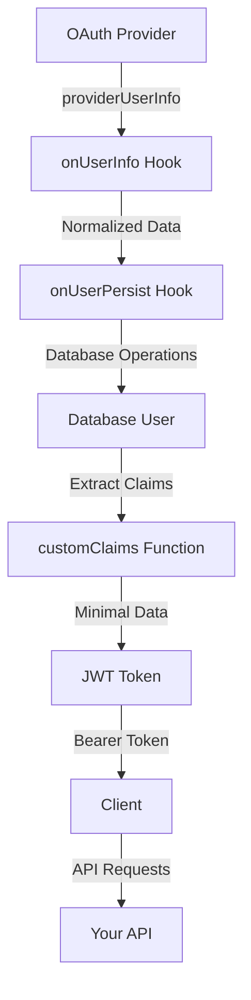

# Data Flow & Transformations

Understanding how user data flows through Nuxt Aegis is crucial for building secure and efficient authentication systems. This guide explains the three distinct types of user data and how they transform throughout the authentication lifecycle.

## Overview

Nuxt Aegis manages three conceptually different types of user data:

1. **Provider Info** - Extracted OAuth provider profile, potentially transformed and enriched
2. **JWT Claims** - Lightweight token payload for authentication
3. **Database User** - Complete application-specific user record

Each serves a different purpose and has different constraints. Mixing them up is a common source of security issues and performance problems.

## The Three Types of User Data

### 1. Provider Info (`providerUserInfo`)

**What it is:** The user profile extracted from an OAuth identity provider's response (Google, GitHub, Microsoft, etc.) after authentication. Configured `onUserInfo` callbacks can transform it, and `onUserPersist` can enrich it before Nuxt Aegis stores it as `providerUserInfo`.

**Characteristics:**
- **Format:** Provider-specific - varies dramatically between providers
- **Availability:** Collected during the initial OAuth callback; retained server-side in refresh-token records when application refresh tokens are enabled
- **Lifecycle:** The transformed/enriched profile is stored as `providerUserInfo` in refresh-token records, not discarded after the OAuth callback
- **Trust level:** Should be validated before use
- **Use case:** Extract user identity to create/update your app's user records

**Examples by provider:**

```typescript
// Google OAuth Response
{
  sub: "1234567890",
  email: "user@example.com",
  email_verified: true,
  name: "John Doe",
  picture: "https://lh3.googleusercontent.com/...",
  given_name: "John",
  family_name: "Doe",
  locale: "en"
}

// GitHub OAuth Response
{
  id: 12345678,
  login: "johndoe",
  email: "user@example.com",
  name: "John Doe",
  avatar_url: "https://avatars.githubusercontent.com/...",
  html_url: "https://github.com/johndoe",
  bio: "Software developer",
  public_repos: 42,
  followers: 100
}

// Microsoft OAuth Response
{
  sub: "AAAAAAAAAAAAAAAAAAAAAIkzqFVrSaSaFHy782bbtaQ",
  name: "John Doe",
  email: "user@example.com",
  userPrincipalName: "user@example.com",
  jobTitle: "Senior Developer",
  officeLocation: "San Francisco"
}
```

**Key insight:** Provider profile formats vary: when application refresh tokens are enabled, Nuxt Aegis retains the transformed/enriched profile in server-side refresh-token storage. Transform it into your application's data model and avoid retaining unnecessary sensitive fields.

### 2. JWT Claims (`AppTokenClaims`)

**What it is:** Your application-specific token payload that gets encoded into the JWT access token and sent with every authenticated request.

**Characteristics:**
- **Format:** Standardized for your application (you define it)
- **Availability:** Sent with every API request in the `Authorization` header
- **Lifecycle:** Lives for the token's lifetime (typically 15-60 minutes)
- **Size constraint:** Keep under 1KB for performance
- **Trust level:** Cryptographically signed by your server
- **Use case:** Fast, stateless authentication and authorization checks

**Type definition:**

```typescript
// shared/types/token.ts
import type { CustomTokenClaims } from '#nuxt-aegis'

export type AppTokenClaims = CustomTokenClaims<{
  role: string           // User role (e.g., 'admin', 'user')
  permissions: string[]  // Specific permissions
  organizationId: string // Multi-tenant identifier
}>

// The full token payload includes:
// - sub: user ID
// - email: user email
// - name: display name
// - picture: avatar URL
// - iat: issued at timestamp
// - exp: expiration timestamp
// + your custom claims above
```

**What to include in JWT claims:**

✅ **DO include:**
- User ID (`sub`)
- Basic identity (email, name, picture)
- Authorization data (role, permissions)
- Tenant/organization identifiers
- Small, frequently-needed values

❌ **DON'T include:**
- Passwords or secrets
- Large data (profile descriptions, settings)
- Frequently-changing data (last login time)
- Sensitive personal data (SSN, phone numbers)
- Database implementation details

**Why size matters:**
- Sent with **every request** (bandwidth cost)
- Larger tokens = slower parsing and validation

### 3. Database User (`DatabaseUser`)

**What it is:** The complete, authoritative user record stored in your application's database.

**Characteristics:**
- **Format:** Application-specific (your database schema)
- **Availability:** Persisted permanently, fetched when needed
- **Lifecycle:** Permanent until deleted
- **Size constraint:** No practical limit
- **Trust level:** Source of truth for your application
- **Use case:** Store complete user profile, preferences, settings, and relationships

**Type definition:**

```typescript
// shared/types/database.ts
import type { AppTokenClaims } from './token'

export interface DatabaseUser extends AppTokenClaims {
  id: string
  email: string
  name: string
  picture: string
  
  // Database-specific fields (NEVER in JWT)
  hashedPassword?: string     // For password authentication
  createdAt: string
  lastLogin: string
  emailVerified: boolean
  
  // Multi-provider support
  providers: Array<{
    name: string              // 'google', 'github', 'password'
    id: string                // Provider-specific user ID
  }>
  
  // Application-specific data
  preferences: {
    theme: 'light' | 'dark'
    notifications: boolean
    language: string
  }
  
  // Audit fields
  updatedAt: string
  updatedBy?: string
  
  // Relationships (IDs only, not full objects)
  teamIds: string[]
  projectIds: string[]
}
```

**What to include in database:**

✅ **DO include:**
- Everything from JWT claims (for reference)
- Hashed passwords and credentials
- Multi-provider authentication records
- Detailed profile information
- User preferences and settings
- Audit trails (created, updated timestamps)
- Relationships to other entities
- Large or rarely-needed data

## Data Transformation Flow

Here's how data flows through the authentication process:



### Step-by-Step Transformation

#### Step 1: OAuth Callback (Provider → `providerUserInfo`)

When a user authenticates with an OAuth provider, you receive provider-specific data:

```typescript
// This is automatically provided by Nuxt Aegis
const providerUserInfo = {
  sub: "1234567890",
  email: "john@example.com",
  name: "John Doe",
  email_verified: true,
  // ... other provider-specific fields
}
```

#### Step 2: Normalize (`onUserInfo` Hook)

Transform provider-specific data into a consistent format:

```typescript
// server/plugins/aegis.ts
defineAegisHandler({
  onUserInfo: async (payload) => {
    // Normalize field names across providers
    if (!payload.providerUserInfo.id && payload.providerUserInfo.sub) {
      payload.providerUserInfo.id = payload.providerUserInfo.sub
    }
    
    // Add metadata
    payload.providerUserInfo.authenticatedAt = new Date().toISOString()
    payload.providerUserInfo.authProvider = payload.provider
    
    return payload.providerUserInfo
  }
})
```

#### Step 3: Persist (`onUserPersist` Hook)

Create or update the database user and return enrichment data to merge into `providerUserInfo`. These fields do not automatically become JWT claims:

```typescript
// server/plugins/aegis.ts
defineAegisHandler({
  onUserPersist: async (user, { provider }) => {
    const email = user.email as string
    const providerId = String(user.id || user.sub)
    
    // Check if user exists
    let dbUser = findUserByProvider(provider, providerId)
    
    if (!dbUser) {
      const existingUser = getUserByEmail(email)
      if (existingUser) {
        throw new Error('Sign in to your existing account to link this provider')
      }

      dbUser = createUser({
        email,
        name: user.name as string,
        picture: user.picture as string,
        role: 'user',
        permissions: ['read'],
        organizationId: 'default',
        providers: [{ name: provider, id: providerId }],
        createdAt: new Date().toISOString(),
        lastLogin: new Date().toISOString()
      })
    }
    
    // Update last login
    updateUser(dbUser.id, { lastLogin: new Date().toISOString() })
    
    // Enrich the profile for subsequent customClaims resolution
    return {
      userId: dbUser.id,
      role: dbUser.role,
      permissions: dbUser.permissions,
      organizationId: dbUser.organizationId
    }
  }
})
```

#### Step 4: Create JWT (`customClaims`)

Explicitly select enrichment fields and provider-specific claims for the JWT. This callback receives the profile after persistence enrichment. Provider-level `customClaims` replaces the global handler fallback, so include all required custom claims here:

```typescript
// server/routes/auth/google.ts
export default defineOAuthGoogleEventHandler({
  customClaims: async (user, tokens) => {
    return {
      role: user.role,
      permissions: user.permissions,
      organizationId: user.organizationId,
      emailVerified: user.email_verified || false,
      locale: user.locale || 'en'
    }
  }
})
```

The final JWT payload combines:
- Selected identity fields (`sub`, `email`, `name`, `picture`) and provider name
- Explicitly resolved custom claims, subject to reserved-claim filtering
- Signing metadata such as `iat` and `exp`

Other enrichment fields remain in `providerUserInfo` unless explicitly selected by `customClaims`. Returning `userId` from `onUserPersist` does not set `sub`: the subject is selected from the enriched profile's `sub`, then `email`, then `id`.

```typescript
// Resulting JWT payload:
{
  sub: "1234567890",
  email: "john@example.com",
  name: "John Doe",
  picture: "https://...",
  provider: "google",
  role: "user",                    // selected by customClaims
  permissions: ["read"],           // selected by customClaims
  organizationId: "default",       // selected by customClaims
  emailVerified: true,             // from customClaims
  locale: "en",                    // from customClaims
  iat: 1703419200,
  exp: 1703422800
}
```

#### Step 5: Client Usage

The client receives the JWT and uses it for authentication:

```typescript
// Client-side (app.vue)
const { user } = useAuth<AppTokenClaims>()
const { $api } = useNuxtApp()

// Access typed custom claims
console.log(user.value?.role)           // 'user'
console.log(user.value?.permissions)    // ['read']

// API calls automatically include the token
const response = await $api('/api/protected')
```

#### Step 6: Server-side Authorization

After authentication middleware verifies the JWT and populates the request context, your API routes enforce authentication and use claims for application-specific authorization. `requireAuth()` throws a 401 if no user is present and narrows the context type; it does not verify the JWT itself. `getAuthUser()` only reads the context and can return `null`, so callers must handle absence before accessing claims.

```typescript
// server/api/admin.ts
import { defineEventHandler, createError } from 'nuxt/server'

export default defineEventHandler(async (event) => {
  const authedEvent = requireAuth<AppTokenClaims>(event)
  const user = authedEvent.context.user
  
  // Use claims for authorization
  if (user.role !== 'admin') {
    throw createError({ status: 403, message: 'Admin access required' })
  }
  
  // Optionally fetch full database user for complex operations
  const dbUser = await getUserById(user.sub)
  
  return {
    message: 'Admin data',
    preferences: dbUser.preferences
  }
})
```

## Common Patterns & Best Practices

### Pattern 1: Multi-Provider Account Linking

Do not automatically link accounts by matching email addresses. Nuxt Aegis delegates persistence and account-linking decisions to the application through `onUserPersist`; it does not verify email ownership or authorize linking.

For ordinary sign-in, look up an existing provider identity and reject email collisions rather than attaching the provider to another account:

```typescript
defineAegisHandler({
  onUserPersist: async (user, { provider }) => {
    const email = user.email as string
    const providerId = String(user.id || user.sub)
    
    // First check by provider ID
    let dbUser = findUserByProvider(provider, providerId)
    
    if (!dbUser) {
      const existingUser = getUserByEmail(email)
      if (existingUser) {
        throw new Error('Sign in to your existing account to link this provider')
      }

      dbUser = createUser({
        email,
        name: user.name as string,
        providers: [{ name: provider, id: providerId }],
      })
    }
    
    return {
      userId: dbUser.id,
      role: dbUser.role,
      permissions: dbUser.permissions
    }
  }
})
```

Implement linking as a separate application-controlled flow. Require an authenticated session for the target account, explicit user consent, and fresh authentication with the provider being added. Bind the linking request and OAuth callback to that session using single-use, CSRF-protected state that your application generates and validates. Do not assume Nuxt Aegis supplies this protection.

If email is used as evidence, verify ownership through a trusted provider's verified-email assertion or an application verification challenge; an email string or an untrusted `email_verified` field is not proof. Even matching verified emails must not replace authorization to link the target account. Reject provider identities already linked to another account and enforce uniqueness of `(provider, providerId)` in the database transaction that creates the link.

### Pattern 2: Role-Based Access Control (RBAC)

Store roles in database, include in JWT for fast checks:

```typescript
import { createError, defineEventHandler } from 'nuxt/server'
import type { CustomTokenClaims } from '#nuxt-aegis'

// Database: Source of truth
interface DatabaseUser {
  role: 'admin' | 'moderator' | 'user' | 'guest'
  permissions: string[]
}

// JWT: Fast authorization checks
type AppTokenClaims = CustomTokenClaims<{
  role: string
  permissions: string[]
}>

// Middleware: Check without database query
export default defineEventHandler((event) => {
  const user = requireAuth<AppTokenClaims>(event).context.user
  
  if (!user.permissions.includes('write')) {
    throw createError({ status: 403, message: 'Write permission required' })
  }
})
```

### Pattern 3: Minimal JWT, Database Lookup

Keep JWT small, fetch database user only when needed:

```typescript
import { createError, defineEventHandler } from 'nuxt/server'
import type { CustomTokenClaims } from '#nuxt-aegis'

// JWT contains minimal claims
type AppTokenClaims = CustomTokenClaims<{
  role: string
}>

// Fetch full user only for complex operations
export default defineEventHandler(async (event) => {
  const jwtUser = requireAuth<AppTokenClaims>(event).context.user
  
  // Quick authorization check (no DB query)
  if (jwtUser.role !== 'admin') {
    throw createError({ status: 403, message: 'Admin access required' })
  }
  
  // Fetch full user only when needed
  const dbUser = await getUserById(jwtUser.sub)
  
  return {
    profile: dbUser,
    preferences: dbUser.preferences
  }
})
```

### Pattern 4: Provider-Specific Enrichment

Add provider-specific data without cluttering the database:

```typescript
// Google: Email verification status
export default defineOAuthGoogleEventHandler({
  customClaims: (user) => ({
    emailVerified: user.email_verified || false
  })
})

// GitHub: Public repositories count
export default defineOAuthGitHubEventHandler({
  customClaims: (user) => ({
    githubRepos: user.public_repos || 0
  })
})
```

## Security Considerations

### 🔒 Never Put Secrets in JWT

```typescript
// ❌ WRONG - Secrets in JWT
type AppTokenClaims = CustomTokenClaims<{
  hashedPassword: string  // NEVER DO THIS
  apiKey: string         // NEVER DO THIS
  creditCard: string     // NEVER DO THIS
}>

// ✅ CORRECT - Only safe data in JWT
type AppTokenClaims = CustomTokenClaims<{
  role: string
  permissions: string[]
}>

// Store secrets in database only
interface DatabaseUser {
  hashedPassword: string  // OK in database
  apiKeys: string[]      // OK in database
}
```

### 🔒 Validate Provider Data

Provider data is external input and must be validated:

```typescript
import { createError } from 'nuxt/server'

defineAegisHandler({
  onUserInfo: async (payload) => {
    const email = payload.providerUserInfo.email
    
    // Validate email
    if (!email || typeof email !== 'string') {
      throw createError({ status: 400, message: 'Invalid email from provider' })
    }
    
    // Validate email format
    if (!/^[^\s@]+@[^\s@]+\.[^\s@]+$/.test(email)) {
      throw createError({ status: 400, message: 'Invalid email format' })
    }
    
    return payload.providerUserInfo
  }
})
```

### 🔒 Separate Token and Database Types

Use separate types to describe token claims and database records, but explicitly select the fields that may enter a JWT:

```typescript
type AppTokenClaims = CustomTokenClaims<{
  role: string
}>

interface DatabaseUser {
  id: string
  email: string
  role: string
  hashedPassword: string
}

function selectCustomClaims(user: DatabaseUser): Pick<AppTokenClaims, 'role'> {
  return {
    role: user.role,
  }
}
```

Pass the result of `selectCustomClaims` as custom claims, not the full database record or a spread of it. Constructing a new object with explicitly selected fields keeps `hashedPassword` out of that object.

TypeScript types do not remove properties at runtime. A database record can be assignable to a narrower type while still containing extra fields. Type annotations, casts, `Pick`, and `Omit` alone do not sanitize an object; `CustomTokenClaims<T>` combines base and custom claim types rather than excluding secret fields.

Runtime claim filtering removes reserved JWT claim names and unsupported value types, but does not reject names such as `hashedPassword` or `apiKey`. Sensitive strings supplied as custom claims can therefore enter the token. JWT signing protects integrity, not confidentiality: anyone holding the token can decode its payload. Never include passwords, password hashes, API keys, or other secrets in token claims.

## See Also

- [Custom Claims Guide](../guides/custom-claims.md) - Deep dive into JWT customization
- [Type Definitions](../guides/types/) - TypeScript type documentation
- [Event Handlers](../guides/handlers.md) - Hook reference
- [Authentication Flow](./authentication-flow.md) - Complete flow diagrams
- [Token Lifecycle](./token-lifecycle.md) - Token management and refresh