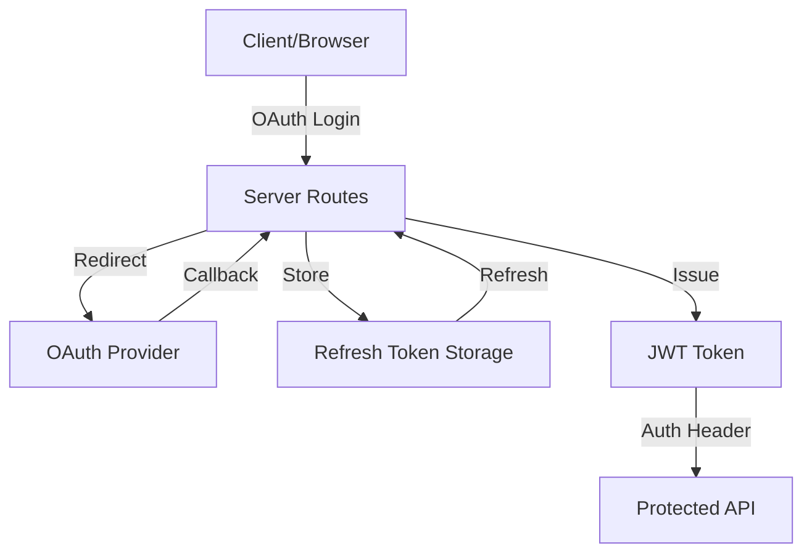
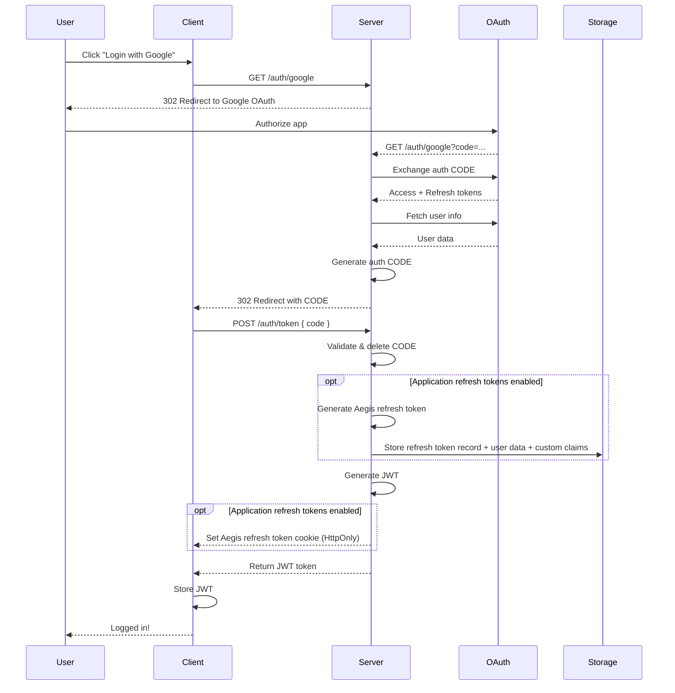
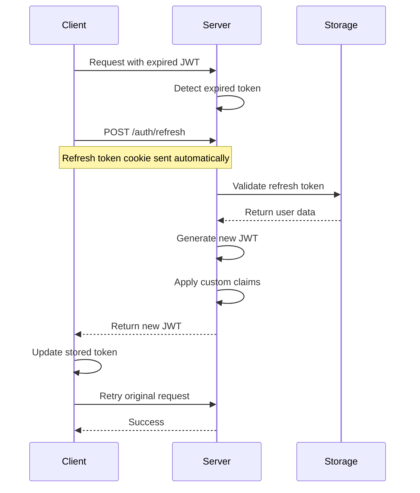
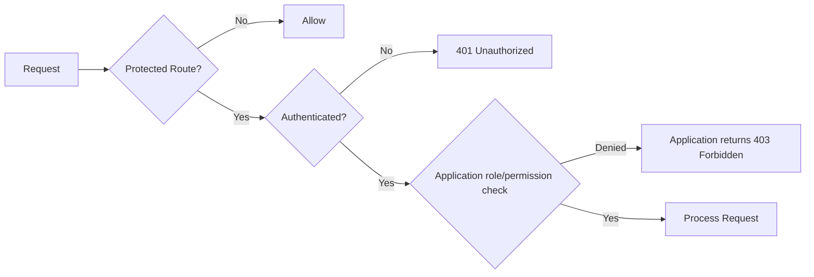
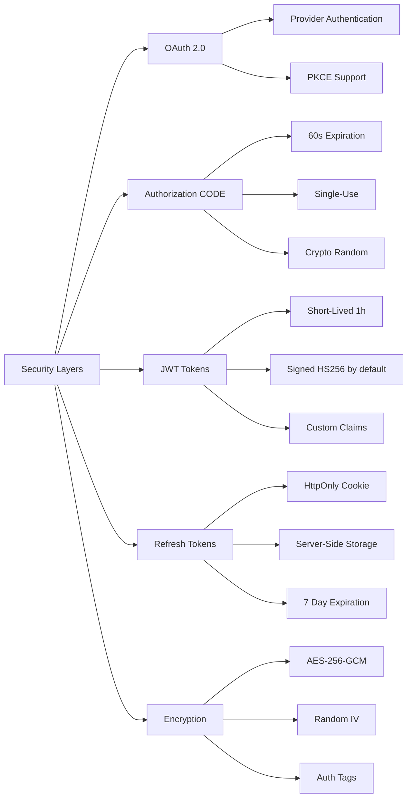
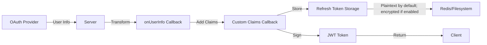

# Architecture

Understanding Nuxt Aegis architecture and authentication flows.

## Overview

Nuxt Aegis implements a secure OAuth 2.0 + JWT authentication system with token refresh and authorization CODE flow.

## Key Components



### Client-Side Components

- **`useAuth()` Composable** - Reactive authentication state management
- **Router Middleware** - Client-side route protection
- **Token Storage** - JWT access token management
- **Refresh Cookie** - HttpOnly refresh token cookie

### Server-Side Components

- **OAuth Routes** - Handle OAuth flows (`/auth/{provider}`)
- **Token Endpoints** - Token exchange and refresh (`/auth/token`, `/auth/refresh`)
- **Server Middleware** - Automatic route protection
- **Server Utils** - `requireAuth()`, `getAuthUser()`
- **Storage Layer** - Persistent refresh token storage (Redis/filesystem)

### Authentication Flow

Detailed authentication flow documentation:

- [Complete Authentication Flow](/architecture/authentication-flow)
- [Token Lifecycle](/architecture/token-lifecycle)
- [Project Structure](/architecture/project-structure)

## Architecture Diagrams

### High-Level Flow



The OAuth callback creates the short-lived Aegis authorization CODE, not the application's refresh token. After the client exchanges that CODE at `POST /auth/token`, the server creates and stores an Aegis refresh token (if enabled) and sets its HttpOnly cookie on the token-exchange response. This token is separate from any refresh token returned by the OAuth provider.

### Token Refresh Flow



### Route Protection Flow



Nuxt Aegis enforces authentication on protected routes by verifying the JWT and applying configured issuer and audience checks. It does not automatically enforce roles or permissions. The authorization check and 403 response shown above must be implemented by application route handlers or middleware; an authenticated user is not necessarily authorized for an operation.

## Security Layers



JWT signing and verification use a shared symmetric secret, with HS256 as the default algorithm. RS256 is not supported yet by the current key handling: setting `token.algorithm` to `'RS256'` does not import an RSA key and causes signing to fail.

## Data Flow

### User Data Storage



User-info transformation uses the provider-level `onUserInfo` callback when configured, otherwise the global Aegis handler's `onUserInfo` callback.

Refresh token records are stored in plaintext by default. To enable AES-256-GCM encryption at rest, set `nuxtAegis.tokenRefresh.encryption.enabled` to `true` and configure an encryption key. See [Storage Configuration](../configuration/storage.md#encryption-at-rest).

### Token Types

| Token Type | Lifetime | Storage | Purpose |
|------------|----------|---------|---------|
| **Authorization CODE** | 60 seconds | Memory | Exchange for JWT |
| **JWT Access Token** | 1 hour | Client (memory only) | API authentication |
| **Refresh Token** | 7 days | Server (Redis/filesystem) | Generate new JWTs |
| **OAuth Provider Tokens** | Provider-dependent | Server authorization-code store (temporary) | Fetch user info and supply configured callbacks |

Provider tokens are retained as `providerTokens` alongside the Aegis authorization code in `authCodeStore` until the code record is consumed or removed. The code's validity period (60 seconds by default) is separate from the provider tokens' lifetime; expiry does not itself guarantee immediate deletion of the stored record.

## Module Integration

```mermaid
graph TB
    A[Nuxt App] --> B[nuxt-aegis Module]
    B --> C[Runtime Plugin]
    B --> D[Server Routes]
    B --> E[Server Middleware]
    B --> F[Composables]
    
    C --> C1[Token Store]
    C --> C2[API Client]
    
    D --> D1[/auth/provider]
    D --> D2[/auth/token]
    D --> D3[/auth/refresh]
    D --> D4[/auth/logout]
    
    E --> E1[Route Protection]
    E --> E2[Token Validation]
    
    F --> F1[useAuth]
    
```

## Performance Considerations

### Caching Strategy

- **JWT tokens**: Short-lived (1h) to balance security and performance
- **Refresh tokens**: Long-lived (7 days) to minimize re-authentication
- **User data and custom claims**: Stored with the refresh token and reused during ordinary refresh; no user-data reload or claims recomputation

To recompute claims explicitly, use `refresh({ updateClaims: true })`, which calls `/auth/update-claims` before refreshing the token. See [Updating JWT Claims](/guides/updating-claims). Without an explicit update, stored roles and permissions can remain stale.

### Scalability

- **Stateless JWTs**: No server-side session storage for access tokens
- **Redis storage**: Horizontal scaling for refresh tokens
- **Token refresh**: Automatic refresh prevents auth interruptions

## Next Steps

- [Complete Authentication Flow](/architecture/authentication-flow)
- [Token Lifecycle](/architecture/token-lifecycle)
- [Project Structure](/architecture/project-structure)
