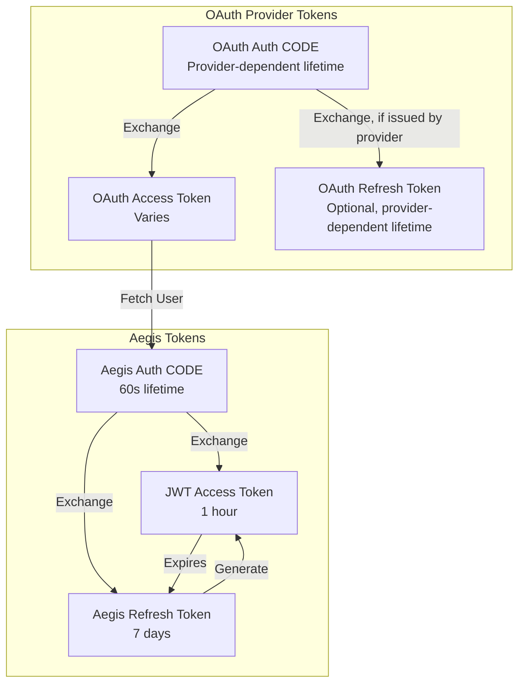
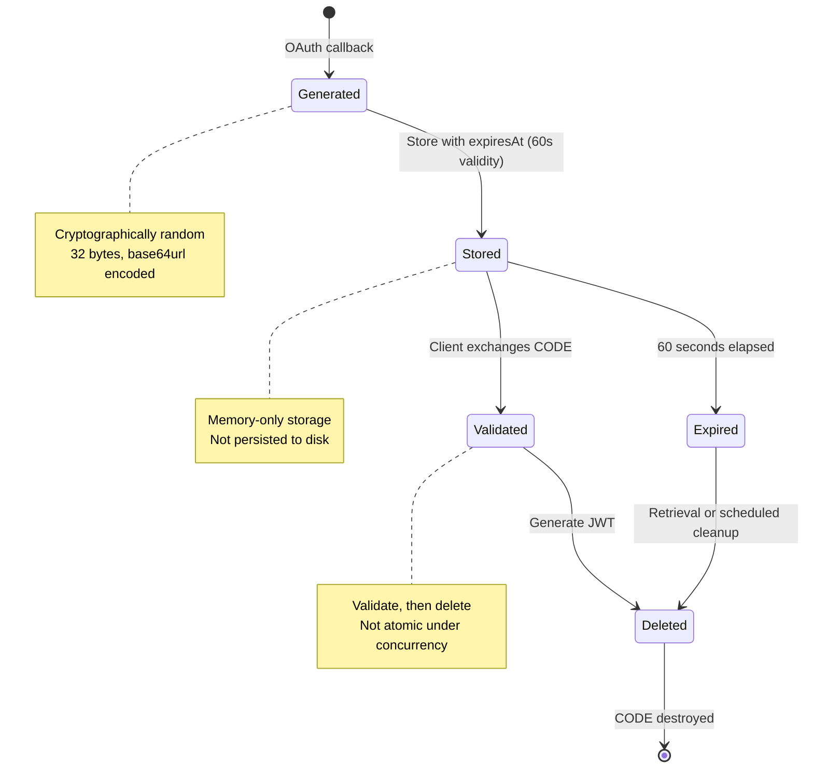
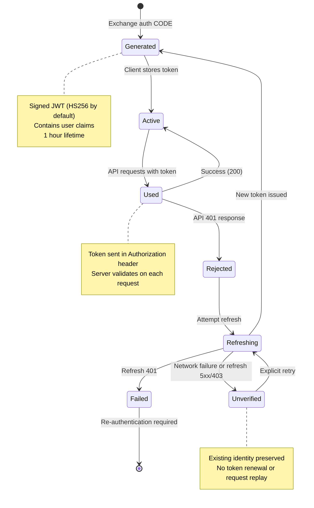
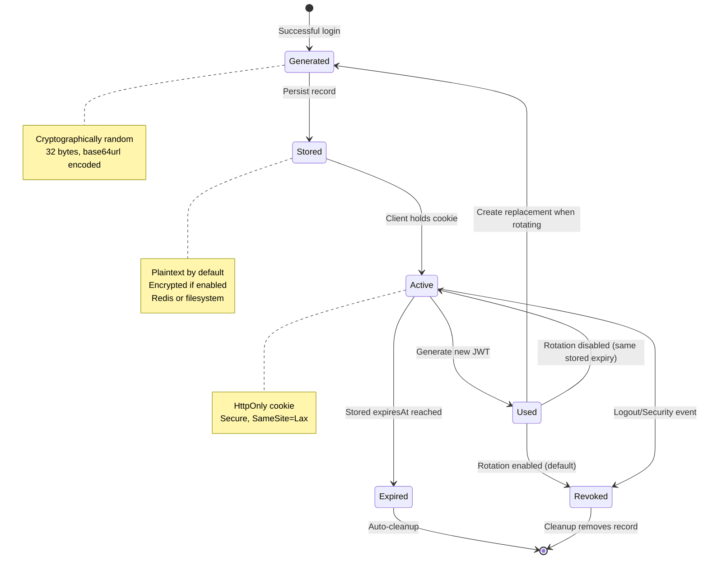

# Token Lifecycle

Complete lifecycle of tokens from generation through refresh to expiration.

## Overview

Nuxt Aegis manages multiple types of tokens throughout the authentication process. Each token type has a specific purpose, lifetime, and security model. This page details the complete lifecycle of each token type.

## Token Types Overview



OAuth authorization-code lifetimes are defined by the provider, not by Aegis. Providers may return a refresh token depending on the provider, requested scopes, consent, and configuration; the OAuth handler accepts responses without one. Provider refresh tokens are separate from Aegis refresh tokens.

## Token Lifecycle Stages

### 1. Aegis Authorization CODE Lifecycle



  Authorization codes are intended for single use. Once consumption deletes a code, subsequent sequential exchanges are rejected. Validation and deletion are separate operations, however, so concurrent exchanges can both read the same valid code before either deletes it. The current implementation does not guarantee atomic single-use consumption; strict replay prevention under concurrency requires an atomic consume operation or equivalent synchronization.

**Generation**

The module generates a cryptographically random authorization code after authentication and stores the associated user data for the configured lifetime. Applications do not need to generate or store these codes themselves.

**Exchange**

The client submits the code to the module's exchange endpoint. The module validates and consumes it, then issues the access token and refresh-token cookie. Invalid or expired codes are rejected.

**Expiration**
- **Lifetime**: 60 seconds (configurable)
- **Validation**: `expiresAt` is checked on retrieval; expired codes are rejected and removed. Storage writes do not set a TTL.
- **Cleanup**: The `cleanup:auth-codes` Nitro task calls `cleanupExpiredAuthCodes()` daily at 02:00 to remove expired, unexchanged codes. Expired records can remain until retrieval or the scheduled sweep, but cannot be exchanged after expiration.
- **Purpose**: Prevent token exposure in redirects

### 2. JWT Access Token Lifecycle



  JWT signing and verification use a shared symmetric secret, with HS256 as the default algorithm. RS256 is not yet supported by the current key handling: setting `token.algorithm` to `'RS256'` does not import an RSA key and causes signing to fail.

**Generation**

The module signs access tokens using `nuxtAegis.token` configuration, combining user identity fields with resolved custom claims and signing metadata. Applications configure token lifetime and claims rather than implementing JWT signing.

**Validation**

Protected routes validate access-token signatures and expiration through the module's authentication middleware. Application-specific role and permission checks remain the application's responsibility. See [Route Protection](/guides/route-protection).

**Token Structure**
```json
{
  "header": {
    "alg": "HS256"
  },
  "payload": {
    "sub": "google|123456789",
    "email": "user@example.com",
    "name": "John Doe",
    "picture": "https://...",
    "role": "admin",
    "permissions": ["read", "write"],
    "iat": 1703001600,
    "exp": 1703005200,
    "iss": "nuxt-aegis"
  },
  "signature": "..."
}
```

**Refresh Flow (On-Demand)**
```mermaid
sequenceDiagram
    participant Client
    participant APIPlugin
    participant Server
    participant Storage
    
    Client->>Server: API request with expired JWT
    Server-->>Client: 401 Unauthorized
    
    Note over Client,APIPlugin: Interceptor catches 401
    APIPlugin->>APIPlugin: API request rejected; session not yet determined
    APIPlugin->>Server: POST /auth/refresh
    Note over APIPlugin,Server: Refresh token cookie sent automatically
    
    Server->>Server: Extract refresh token from cookie
    Server->>Storage: Validate refresh token
    
    alt Token Valid
      Storage-->>Server: Stored provider profile and custom claims
      Server->>Server: Reuse stored identity fields and custom claims
      Server->>Server: Generate new JWT with fresh signing metadata
      Server-->>APIPlugin: { success: true, message, accessToken: NEW_JWT }
        APIPlugin->>APIPlugin: Update stored token
        APIPlugin->>Server: Retry original request
        Server-->>Client: API response; propagate a replayed 401
    else Token Invalid/Expired
        Storage-->>Server: Token not found
        Server-->>APIPlugin: 401 Unauthorized; clear refresh cookie
        APIPlugin->>APIPlugin: Clear auth state
        APIPlugin-->>Client: Redirect to error page
      else Verification unavailable or refresh prohibited
        Server-->>APIPlugin: 5xx or 403; cookie not cleared
        APIPlugin->>APIPlugin: Preserve identity; record structured error
        APIPlugin-->>Client: Reject with refresh failure; no replay or redirect
    end
```

Ordinary refresh (`POST /auth/refresh` or `useAuth().refresh()`) reuses the provider profile and custom claims already stored in the refresh-token record. It does not fetch a fresh provider profile, reload application user data, or rerun `onUserPersist` or `customClaims` callbacks. Roles and permissions can therefore remain stale even after a new JWT is issued.

An API 401 rejects that request, not necessarily the refresh session. The client shares one refresh attempt and replays at most once after success. A failed refresh never extends access-token validity or authorizes the failed request.

At startup, `ensureResolved()` treats refresh 401 as a quiet guest result. Network, 5xx, and forbidden failures reject while status remains unknown. Established identity, including server-verified identity carried through hydration, is preserved on those failures. Consumers can explicitly retry; there is no background retry loop.

Use `refresh({ updateClaims: true })` to request explicit claims recomputation via `/auth/update-claims` before refreshing the token. See [Updating JWT Claims](/guides/updating-claims) for configuration and handler requirements.

**Configuration**
```typescript
export default defineNuxtConfig({
  nuxtAegis: {
    token: {
      expiresIn: 3600, // 1 hour (seconds)
      algorithm: 'HS256',
      secret: process.env.NUXT_AEGIS_JWT_SECRET,
    },
    tokenRefresh: {
      cookie: {
        cookieName: 'nuxt-aegis-refresh',
        maxAge: 604800,
      },
    },
  },
})
```

### 3. Refresh Token Lifecycle



**Generation & Storage**

Refresh token records are stored in plaintext by default. AES-256-GCM encryption at rest is opt-in: set `nuxtAegis.tokenRefresh.encryption.enabled` to `true` and configure an encryption key. See [Storage Configuration](../configuration/storage.md#encryption-at-rest).

The module generates and stores refresh tokens automatically; applications do not need to implement token generation or storage writes. The raw token goes in the `nuxt-aegis-refresh` cookie by default, while its SHA-256 hash is the key in the `refreshTokenStore` storage mount. Each record contains `providerUserInfo`, the provider name, stored custom claims, `expiresAt`, and `isRevoked`. Expiration is recorded in `expiresAt` rather than supplied as a storage TTL.

**Usage & Refresh**

`POST /auth/refresh` validates that the stored refresh-token record exists, is not revoked, and has not passed its `expiresAt`. It generates a new access token using the stored provider profile and custom claims, then applies `nuxtAegis.tokenRefresh.rotationEnabled`:

- **Rotation enabled (default):** Generate and store a replacement refresh token with a new `expiresAt`, set the replacement cookie, and mark the old token as revoked. The old token cannot be used for subsequent refreshes; revocation does not immediately delete its record.
- **Rotation disabled:** Reuse the existing refresh token and re-set its cookie with the configured `maxAge`. This renews the browser cookie lifetime but does not update the stored record or extend its `expiresAt`. Once the stored expiration is reached, refresh fails even if the browser still holds the cookie.

New refresh-token records expire after `tokenRefresh.cookie.maxAge` seconds from creation (default: 604800 seconds, or 7 days). A successful refresh returns `{ success: true, message: 'Token refreshed successfully', accessToken }`.

Missing, unknown, revoked, or expired refresh tokens return 401 and clear the cookie. Prohibited operations return 403 without invalidating the original cookie; unexpected failures return 5xx without clearing it. Inability to verify is not session invalidation.

**Revocation (Logout)**

Use the module's logout flow to revoke the current refresh token and clear its cookie. Revoked records remain in storage until cleanup; applications do not need to delete them directly.

**Storage Configuration**
```typescript
export default defineNuxtConfig({
  nitro: {
    storage: {
      refreshTokenStore: {
        driver: 'redis', // or 'fs', 'memory'
        host: process.env.REDIS_HOST,
        port: Number(process.env.REDIS_PORT || 6379),
        password: process.env.REDIS_PASSWORD,
        db: 0,
      },
    },
  },
  
  nuxtAegis: {
    tokenRefresh: {
      cookie: {
        maxAge: 604800, // 7 days (seconds)
        cookieName: 'nuxt-aegis-refresh',
      },
    },
  },
})
```

## Token Comparison

| Feature | Authorization CODE | JWT Access Token | Refresh Token |
|---------|-------------------|------------------|---------------|
| **Lifetime** | 60 seconds | 1 hour | 7 days |
| **Storage** | Memory (server) | Client (memory) | Server + Cookie |
| **Purpose** | Exchange for tokens | API authentication | Generate new JWTs |
| **Security** | Random, sequential reuse rejected; consumption is not atomic | Signed, short-lived | HttpOnly cookie, opt-in encryption at rest |
| **Transmission** | URL parameter | Authorization header | Cookie |
| **Revocable** | Auto-expires | No (stateless) | Yes (marked revoked) |
| **Size** | ~44 bytes | ~200-500 bytes | ~44 bytes |

## Cleanup & Maintenance

### Automatic Cleanup with Nitro Tasks

Nuxt Aegis uses Nitro's scheduled tasks feature to clean up expired authorization codes, expired or revoked refresh tokens, expired magic codes, and expired password reset sessions. These tasks run daily at 2:00 AM by default, and can be configured.

The `cleanup:auth-codes` task calls `cleanupExpiredAuthCodes()` to sweep `authCodeStore`. It can also be invoked manually with `runTask('cleanup:auth-codes')`.

**Refresh Token Cleanup Task**

The built-in `cleanup:refresh-tokens` task removes expired and revoked records from refresh-token storage. Applications do not need to implement this task.

**Task Schedule Configuration**

The module enables Nitro tasks and registers each cleanup task on the daily 02:00 schedule unless that task already has an explicit schedule in `nitro.scheduledTasks`.

**Custom Schedule**

Configure a schedule in your Nuxt configuration to replace the daily default for the listed cleanup tasks. This example schedules all four tasks every six hours, without an additional 02:00 run:

```typescript
export default defineNuxtConfig({
  nitro: {
    scheduledTasks: {
      // Run cleanup every 6 hours
      '0 */6 * * *': [
        'cleanup:auth-codes',
        'cleanup:refresh-tokens',
        'cleanup:magic-codes',
        'cleanup:reset-sessions',
      ],
    },
  },
})
```

If you configure only some cleanup tasks, the remaining tasks keep the daily 02:00 default. Unrelated tasks and explicitly configured multiple schedules are preserved, including tasks at the same 02:00 cron entry.

**Manual Cleanup**

An application server route can invoke the built-in task. Protect such a route with application-specific administrator authorization before exposing it.

```typescript
import { defineEventHandler } from 'nuxt/server'
import { runTask } from 'nitropack/runtime'

export default defineEventHandler(async () => {
  return await runTask('cleanup:refresh-tokens')
})
```

### Token Revocation

**End the Current Session**

Use the public composable from application code:

```typescript
const { logout } = useAuth()
await logout()
```

Refresh-token revocation prevents further refreshes but does not invalidate already-issued access tokens; those remain valid until expiration. For application-specific session management, see the public [Server Utilities](/api/server-utils).

## Next Steps

- [Authentication Flow](/architecture/authentication-flow) - Complete authentication process
- [Project Structure](/architecture/project-structure) - Codebase organization
- [Token Refresh Guide](/guides/token-refresh) - Implementing token refresh
