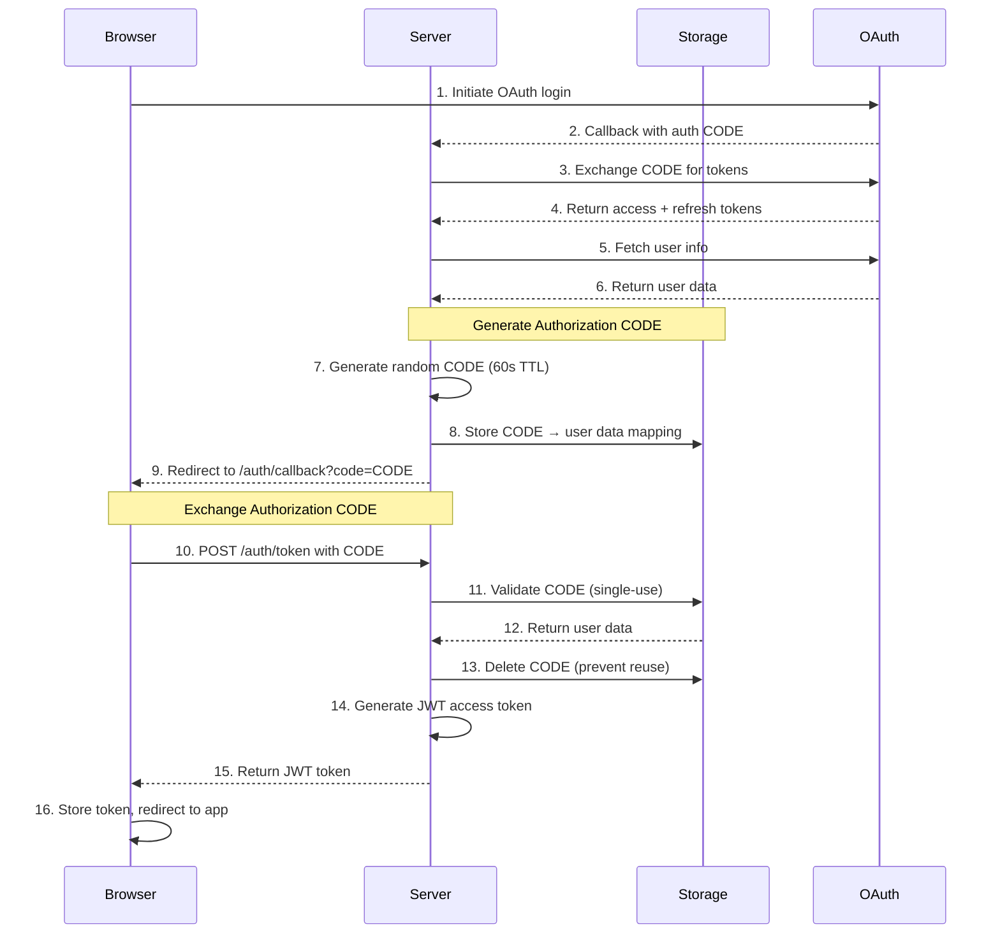
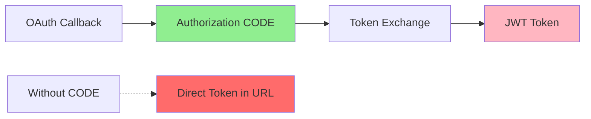

# Authorization CODE Flow

An additional security layer with short-lived authorization CODEs between OAuth callback and token exchange.

## Overview

Nuxt Aegis implements an authorization CODE flow to prevent token exposure in browser redirects. This adds a security layer where tokens never appear in URLs or browser history.

## How It Works



**The flow:**

1. **OAuth Provider** → Server receives auth CODE
2. Server exchanges CODE for provider tokens
3. Server retrieves user info
4. **Server generates authorization CODE** (60s lifetime)
5. Server stores CODE with user data in memory
6. Server redirects to `/auth/callback?code=CODE`
7. **Client calls** `/auth/token` **with CODE**
8. Server validates CODE (single-use)
9. Server generates JWT tokens
10. Server returns access token to client

## Configuration

```typescript
export default defineNuxtConfig({
  nuxtAegis: {
    authCode: {
      expiresIn: 60, // CODE lifetime in seconds (default: 60)
    },
  },
})
```

## Security Features

### Short-Lived

Authorization CODEs expire quickly (60 seconds by default):

```typescript
export default defineNuxtConfig({
  nuxtAegis: {
    authCode: {
      expiresIn: 60, // Adjust as needed (30-120 seconds recommended)
    },
  },
})
```

::: tip Expiration Balance
- **Too short** (< 30s): May cause issues on slow connections
- **Too long** (> 120s): Increases attack window
- **Recommended**: 60 seconds (default)
:::

### Single-Use

The module validates each CODE's expiration and deletes it before generating tokens. Authorization-code storage helpers are internal implementation details, not public server utilities.

::: danger Single-Use Enforcement
Reusing a consumed CODE results in a 401 error. A process-local guard rejects overlapping exchanges for the same CODE before storage access, and the CODE is deleted before exchange data is returned. Storage failures do not return exchange data and always release the guard.

This guarantee applies within one process only. Storage validation and deletion remain separate operations. Multiple workers or instances sharing authorization-code storage require a backend-native atomic consume operation; configuring shared Nitro storage alone does not prevent concurrent replay across processes.
:::

### Cryptographically Secure

CODEs are generated using `crypto.randomBytes(32)`:

```typescript
import { randomBytes } from 'crypto'

function generateAuthCode(): string {
  return randomBytes(32).toString('base64url')
}
```

### Memory Storage

CODEs are stored in memory (not persisted to disk):

```typescript
export default defineNuxtConfig({
  nitro: {
    storage: {
      authCodeStore: {
        driver: 'memory', // In-memory only
      },
    },
  },
})
```

::: info Non-Persistent
Authorization CODEs are intentionally NOT persisted. If the server restarts during the OAuth flow, users simply retry the login.
:::

### Expired CODEs

An expired CODE is rejected and removed when it is looked up. The module does not currently schedule a periodic authorization-code cleanup task.

## Why Use This Approach?

### Prevents URL Token Exposure

**Without authorization CODE:**
```
https://myapp.com/auth/callback?access_token=eyJhbGciOiJIUzI1NiIsInR5cCI6IkpXVCJ9...
```

❌ Token visible in browser history  
❌ Token visible in server logs  
❌ Token visible in referer headers

**With authorization CODE:**
```
https://myapp.com/auth/callback?code=random_short_lived_code
```

✅ Token never appears in URL  
✅ CODE expires quickly (60s)  
✅ CODE is single-use only

### Reduced Attack Surface

- **Short lifetime**: CODEs expire in 60 seconds
- **Single-use**: CODEs can't be replayed
- **Server-side validation**: Client can't forge CODEs
- **No token leakage**: Tokens only travel in HTTP bodies (POST requests)

### Better Security



**With CODE (Secure):**
- CODE in URL (short-lived, single-use)
- Token in POST body (never in URL)

**Without CODE (Less Secure):**
- Token directly in URL (permanent in history)

### Single-Use Enforcement

```typescript
// First exchange - SUCCESS
await $fetch('/auth/token', {
  method: 'POST',
  body: { code: 'abc123' }
})
// Returns: { accessToken: 'jwt-token', tokenType: 'Bearer', expiresIn: 3600 }

// Second exchange with same CODE - FAILURE
await $fetch('/auth/token', {
  method: 'POST',
  body: { code: 'abc123' }
})
// Throws: 401 Invalid or expired CODE
```

## Implementation Details

### Generating CODEs

After successful provider authentication, the module generates and stores a CODE with the complete provider user data, provider name, resolved custom claims, and expiration time. Applications do not need to implement their own code store.

### Exchanging CODEs

The module provides `POST /auth/token`; do not create a replacement route. It consumes the CODE and calls `generateAuthTokens(event, providerUserInfo, provider, customClaims)` using the stored data. When refresh is enabled, it sets the refresh token as a configured HttpOnly cookie, never in the JSON response.

The response contains `accessToken`, `tokenType: 'Bearer'`, and optional `expiresIn` in seconds. For example, a `1h` access-token lifetime produces `expiresIn: 3600`.

The module's callback page exchanges the CODE, stores the access token in memory, updates authentication state, clears the URL query, and redirects. The HTTP exchange itself has this shape, where `code` is the string from the callback URL:

```typescript
import type { TokenExchangeResponse } from '#nuxt-aegis/types'

const { accessToken, tokenType, expiresIn } = await $fetch<TokenExchangeResponse>('/auth/token', {
  method: 'POST',
  body: { code },
})
```

### Error Handling

- **400:** Missing authorization code.
- **401:** Invalid, expired, or already consumed authorization code.
- **500:** Authentication token generation failed.

The module's callback page displays a generic authentication failure and redirects to `nuxtAegis.redirect.error`. Users must restart login after an invalid or expired CODE; retrying the same consumed CODE will not succeed.

## Testing Authorization CODE Flow

The following test sketch assumes fixture helpers that create valid and expired CODEs in the module's internal store. These helpers are application-specific, not module exports.

```typescript
import { describe, it, expect } from 'vitest'
import { $fetch } from '@nuxt/test-utils/e2e'
import type { TokenExchangeResponse } from '#nuxt-aegis/types'

describe('Authorization CODE Flow', () => {
  it('should exchange valid CODE for token', async () => {
    // Generate mock CODE
    const code = await generateMockAuthCode()
    
    // Exchange CODE
    const response = await $fetch<TokenExchangeResponse>('/auth/token', {
      method: 'POST',
      body: { code }
    })
    
    expect(response.accessToken).toBeDefined()
    expect(response.tokenType).toBe('Bearer')
  })
  
  it('should reject expired CODEs', async () => {
    const code = await generateExpiredAuthCode()
    
    await expect($fetch('/auth/token', {
      method: 'POST',
      body: { code }
    })).rejects.toThrow('401')
  })
  
  it('should reject reused CODEs', async () => {
    const code = await generateMockAuthCode()
    
    // First exchange - success
    await $fetch('/auth/token', {
      method: 'POST',
      body: { code }
    })
    
    // Second exchange - should fail
    await expect($fetch('/auth/token', {
      method: 'POST',
      body: { code }
    })).rejects.toThrow('401')
  })
})
```

## Best Practices

::: tip Recommendations
1. **Keep expiration short** - 60 seconds is a good balance
2. **Enforce single-use** - Delete CODEs immediately after exchange
3. **Use memory storage** - CODEs don't need persistence
4. **Generate securely** - Use `crypto.randomBytes(32)`
5. **Clean up expired CODEs** - Prevent memory leaks
6. **Handle errors gracefully** - Redirect to login on CODE expiration
7. **Never log CODEs** - Treat like passwords
:::

::: warning Common Pitfalls
- Don't store CODEs in persistent storage (use memory)
- Don't extend expiration beyond 2 minutes
- Don't allow CODE reuse (delete after exchange)
- Don't expose CODEs in error messages or logs
:::

## Next Steps

- [Learn about token refresh](/guides/token-refresh)
- [Configure storage backends](/configuration/storage)
- [Review security best practices](/security/best-practices)
